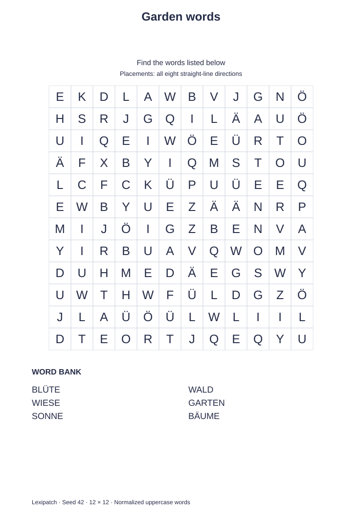

# Lexipatch

Your letters. Your puzzle.

Lexipatch makes repeatable word-search worksheets from your own vocabulary and filler alphabet. Keep all listed words, review every placement, and download separate puzzle and answer files.



This is a real puzzle export. Native browser visuals, responsive and assistive-technology behavior, font coverage, actual downloads and physical printing remain unverified. A real application screenshot has not been captured; automated UI checks use a simulated DOM.

## What it does

- Uses your own words and a separate filler alphabet.
- Supports precomposed accented letters, Hangul syllables and other supported single-code-point Unicode letters.
- Offers across/down placement or all eight straight-line directions.
- Produces the same layout from the same normalized letters, settings, seed and algorithm version.
- Verifies every intended word and checks the remaining cells against your filler alphabet.
- Scans all eight directions for extra occurrences of each listed word.
- Exports separate A5-sized puzzle and answer SVGs, plus editable projects and full reviews.

Everything runs locally. No account, uploads, analytics, external fonts, dictionaries or runtime dependencies. There is no autosave: download a project before closing.

## Run locally

Use Node.js 22 or 24 and npm:

```sh
npm ci --ignore-scripts --no-audit --no-fund
npm test
npm run build
npm run dev
```

Open **http://127.0.0.1:4219**. The workspace starts with an original selection of common garden words.

The production build copies eleven allowlisted static assets into `dist/`. The pinned jsdom development dependency is used by tests.

## Make a puzzle

1. Give the puzzle a title and enter one word per line.
2. Choose a filler alphabet. It controls unused cells only; listed words may contain additional letters.
3. Choose rows, columns and placement directions.
4. Enter a seed, then select **Make puzzle**.
5. Review the normalized word list, placements and extra-occurrence count.
6. Download **Puzzle SVG** for a worksheet and **Answer SVG** for its intended paths.
7. Save a project to keep inputs and settings.

**Next seed** increments the seed and rebuilds the current draft; it wraps from 4,294,967,295 to 0. It changes the random arrangement, not a measured difficulty level.

Edits disable downloads until another complete successful build. An invalid draft or a failed search keeps the previous complete puzzle visible, explicitly marked as a previous puzzle. No partial puzzle or silently shortened word list is exported.

The preview can show answer paths. The **Puzzle SVG** download always omits those highlights, independently of the preview setting.

## Letters and normalization

Input words are trimmed, normalized to NFC, uppercased using Unicode default casing, then normalized to NFC again. The word bank shows the actual normalized letters used in the grid.

For example:

| Input | In the grid |
| --- | --- |
| `blüte` | `BLÜTE` |
| `straße` | `STRASSE` |
| decomposed `u + ◌̈` in a word | precomposed `Ü` where NFC permits |
| `하늘` | `하늘` |

This can change spelling or expand a character. It is not language-aware casing, transliteration, translation or spelling correction. Different Unicode data versions may differ for unusual characters; keep a receipt if you need to archive an exact grid.

Each cell holds one Unicode **letter code point**. Remaining combining marks, punctuation, spaces within words, digits, emoji and joiners are rejected. This does not support every writing system, grapheme cluster, contextual shape or reading convention. Font availability and rendering must be reviewed on your device.

The filler alphabet undergoes the same normalization and uppercasing. Whitespace is removed and duplicate letters are removed in first-occurrence order. The complete normalized alphabet appears below the placement table.

Words must be unique after normalization, so `tree` and `TREE` cannot be separate entries.

## Layout and failure behavior

The versioned generator uses a seeded pseudorandom sequence and a bounded greedy search:

- Longer words are attempted first.
- Every legal start/direction candidate is checked against the current grid.
- Existing equal letters can overlap; conflicting letters cannot.
- Higher-overlap candidates are preferred, with seeded selection among ties.
- Failed layouts are retried, up to eight attempts and 250,000 candidate checks in total.
- Unused cells are filled only from your chosen normalized alphabet.

A failed search does **not** prove that a layout is impossible. Enlarge the grid, reduce the word list, change direction settings or try another seed.

This is not an optimal packer, uniform random sampler, cryptographic generator or measured difficulty model. Saving a project retains inputs; saving a receipt also retains the exact generated grid and algorithm identifier.

## Occurrences and answer keys

The independent audit verifies:

- Project and vocabulary identity.
- Grid shape and one-letter cells.
- A legal, complete intended path for every listed word.
- Filler alphabet membership in every unused cell.
- Search receipt bounds.
- An independent all-direction scan finding every intended word.

It also reports **extra physical occurrences of the listed words**. The scan always checks all eight directions, even when intended placements use across/down only. An extra backward or diagonal occurrence may therefore appear in an across/down puzzle.

Reversing the same physical palindrome path counts once. Substrings, reverse-word pairs and accidental filler matches can still create additional occurrences. The answer SVG highlights one intended placement per word; the JSON and HTML reviews include every scanned listed-word occurrence.

This is not a dictionary or profanity scan. Unlisted words can appear. There is no guarantee of uniqueness, cultural suitability, educational effectiveness, age-appropriate difficulty or absence of unintended language. Review the grid before sharing.

## Files, printing and answers

| Download | Contents |
| --- | --- |
| `lexipatch-puzzle.svg` | Grid, title, normalized word bank, direction note and seed; no answer highlights or private notes |
| `lexipatch-answer.svg` | Same puzzle with intended paths highlighted |
| `lexipatch-project.json` | Raw inputs, settings and notes for reopening |
| `lexipatch-receipt.json` | Project, exact grid, intended placements, all listed-word occurrences and statistics |
| `lexipatch-review.html` | Complete puzzle, expandable answer key, positions, all occurrences and notes |
| `lexipatch-grid.txt` | Every row of letters, separated by spaces |

SVG files have physical dimensions **148 × 210 mm** and a 740 × 1050 viewBox. They are vector documents, not PDFs. Open a downloaded SVG in a compatible viewer and review paper size, scaling, margins and font coverage before printing. Dense grids and long word labels can be small. Physical output and exact page fit have not been tested.

The preview keeps the SVG readable at a fixed width and scrolls on smaller screens; a spaced-text grid is available as an alternative. Native touch and screen-reader behavior remain unverified.

Student files include the grid, word bank and seed. They are not secure tests: the answer can be solved or regenerated. The full HTML review contains the key even when its details are collapsed. Do not distribute it as an answer-free worksheet.

Projects and reviews include private inputs and notes. Sharing them shares that material. Word and alphabet line endings are preserved across metadata-only edits; editing the textarea itself uses browser LF normalization.

The [examples](examples/) contain six actual generated artifacts. The example uses seed 42, a 12 × 12 grid, six words, 24 distinct word cells, 120 filler cells and no extra listed-word occurrences. Regenerate it with `npm run example`.

## Limits

- 1–16 unique normalized words.
- 2–18 letter code points per word; no word longer than both grid dimensions.
- Rows and columns: 6–24.
- Filler alphabet: 2–100 unique normalized letter code points.
- Seed: integer 0–4,294,967,295.
- Title: 80 UTF-16 code units on one line; notes: 500.
- Raw word text: 1,500 code units; raw alphabet text: 500.
- Project import: 72,000 bytes and 18,000 decoded code units.
- Strict UTF-8 imports with an optional leading BOM. Unsafe ASCII controls, unpaired surrogates and U+FFFE/U+FFFF are rejected.

There is no themed word database, AI generation, image import, batch book production, interactive drag-to-solve game, timers, progress tracking, cloud storage, PDF engine or automatic printing.

## Verification

`npm test` passes **25 automated checks**: 14 core checks, 10 simulated UI checks and their parent test.

- 300 seeded puzzles across Latin, accented and Hangul lists, both placement modes and custom filler alphabets.
- 100 small grids compared against an independent endpoint-based occurrence oracle.
- Fourteen deliberately damaged grids or receipts rejected.
- Normalization, case expansion, astral letter code points, duplicates, bounds, deterministic seeds and dense-layout failures.
- Separate valid SVG documents, complete HTML/JSON/text exports, literal metadata and strict UTF-8.
- Actual Blob contents, answer-preview separation, seed wraparound, atomic failed drafts, reopening, CRLF preservation and stale import races.

GitHub Actions runs tests and builds on Windows and Linux with Node 22 and 24. These checks do not verify native browser appearance, full accessibility, actual fonts, native download locations or printing.

## Manual Vercel setup

Import this repository into your Vercel account. Use the repository root, **Other** framework, Node **24.x**, build command `npm run build` and output directory `dist`.

The checked-in `vercel.json` supplies the build and security headers. No environment variables, runtime dependency installation or paid services are required. Check the built example and both SVG downloads after deployment.

## License

[MIT](LICENSE). Use vocabulary and other input material you have permission to process.
